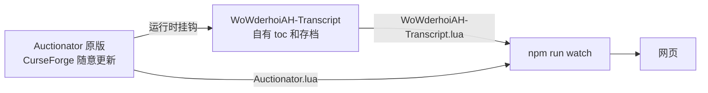

# WoWderhoiAH 四项问题分析与处理

> [!summary] 结论
> | # | 问题 | 根因 | 处理 |
> |---|---|---|---|
> | 1 | 中立拍卖行扫描按钮是灰色 | 只按区域名白名单判定市场，中立拍卖行所在区域不在名单里 → 判定为"未知" → 按钮被禁用 | 改为多级识别：拍卖师阵营 + mapID + 区域，识别不了时打印诊断，并提供 `/wahmarket` 手动指定 |
> | 2 | 获取前五档价格慢 | 自动补档有 bug，扫描后**从未成功运行**；被限流的查询要干等 8 秒超时 | 修复 bug，改为按限流状态排队、4 秒超时重试 |
> | 3 | 雷达与筛选不清晰 | 进池只看单件利润（50 铜），不看能买多少；榜单之间互相重叠 | 改为四种赚金策略，按**总利润**进池和排序；「可做差价」并入「捡漏」 |
> | 4 | 更新 Auctionator 会覆盖改动 | 改动直接写在第三方 Auctionator 的源码和 toc 里 | 拆成独立的旁挂插件，Auctionator 恢复原版，可以随便更新 |

## 1. 中立拍卖行无法扫描（按钮灰色）

### 根因
旧版 `Market.lua` 只用 `GetRealZoneText()` 对照两份白名单：
- 联盟：暴风城 / 铁炉堡 / 达纳苏斯
- 中立：艾尔文森林 / 赤脊山

中立拍卖行所在位置的区域名只要不在名单里，`DetectMarket()` 就返回 `nil`，打开拍卖行时 `ScanButton:Disable()` 被执行，按钮变灰。

### 处理
识别改为按顺序判定（**宁可不扫，也不让两个市场的数据混槽**）：
1. `/wahmarket neutral|faction`：手动指定，只在本次登录有效
2. 联盟主城（按区域名或 mapID 判断）→ 联盟
3. **拍卖师本身是中立阵营**（地精等，`UnitFactionGroup("npc")` 为空）→ 中立
4. 中立区域白名单（原有两个区域，加上加基森 / 藏宝海湾 / 永望镇所在区域）→ 中立
5. 都不满足 → 判定为未知：按钮禁用，聊天框打印 `区域 / 子区域 / 拍卖师阵营 / mapID`

> [!todo] 需要你在游戏内确认
> 到中立拍卖行打开一次拍卖行，看聊天框输出的识别结果。
> - 如果显示"未知"，把诊断信息发给我，我把它加进规则。
> - 临时可以用 `/wahmarket neutral` 手动指定。

顺带修复：旧版只路由了**扫描**写入。在中立拍卖行用出售页时，Auctionator 顺手记录的价格会漏进联盟槽。现在所有价格写入都按"当前打开的拍卖行属于哪个市场"分槽。

## 2. 前五档价格获取慢

> [!warning] 原计划修正
> 我最初设想用全量复制扫描（ReplicateItems）一次在本地算出所有物品的前五档。但 [[AI]] §6.1 实测记录了无限版的全量复制扫描有 **15 分钟硬冷却**，所以放弃这个方案，改为修好"逐物品搜索"这条路径。

### 根因（按影响大小排序）
1. **自动补档从未运行成功**：`StartTierBackfill()` 调用了文件后面才定义的 `local advance`，实际调用的是 `nil`，直接报错（无限版默认不显示脚本错误）。报错前已经把 `running=true` 写进了存档，所以之后每次补档都提示"已有队列在运行"并跳过。结果只能手动 `/wahscan start` 全量逐个搜索，数千个物品。
2. **限流**：被拍卖行限流的查询会被静默丢弃，只能等 8 秒超时后才继续下一个。
3. 任何搜索结果事件（包括 Auctionator 自己发起的搜索）都会推进队列，导致跳过物品或重复推进；搜索没有按价格排序；联盟和中立的档位按 itemId 互相覆盖。

### 处理
- 补档改为由 OnUpdate 驱动的队列：发送前检查 `IsThrottledMessageSystemReady`；超时降到 4 秒，超时后重试 1 次；只认当前物品的结果；按单价升序搜索。
- 每次载入插件时复位 `running`，队列保留，可以用 `/wahscan resume` 续扫。
- 存档改为 `WAHTranscribeDB.markets[faction|neutral]`（v2）：两个市场分开存，4 小时新鲜度判断也分市场。导入端 v1、v2 两种格式都能读。
- TierList 候选清单覆盖两个市场，并包含跨市场候选。

## 3. 雷达与筛选：精简为清晰的赚金思路

用户拍板：完整版，6 个筛选项全保留，恢复跨市场，「可做差价」并入「捡漏」。

**每一行就是一个可以直接执行的动作**：买什么、买多少、卖到哪、赚多少。进池和排序都按 **总利润 = 单件利润 × 可买量**。

| 策略 | 买 | 卖 | 进池门槛（默认，可在雷达设置里调） |
|---|---|---|---|
| **必赚** | 所有低于 NPC 收购价的档位 | 卖给 NPC | 总利润 ≥ 10 银，不需要历史数据 |
| **扫货** | 便宜的前 k 档 | 挂在 min(下一档价 −1 铜, 7 日参考) | 单件 ≥ max(20 银, 买价 15%)，总利润 ≥ 1 金，历史 ≥ 3 天，≥ 2 个不同收盘价 |
| **跨市场** | 当前市场 | 另一市场最低价 −1 铜 | 门槛同扫货；两边数据都必须在 48 小时内 |
| **波段**（原可做差价） | 跌破 7 日带下沿的高波动、需求广的物品 | 回到 7 日参考价 | 保持原「可做差价」的门槛 |

- 有前五档数据时按真实档位"扫货"：逐个尝试买入前 k 档，取总利润最大、且最贵那一件仍达标的方案。没有档位数据时，可买量按 1 计（表格里显示为 `~1`），只校验单件门槛。
- 筛选项：策略 / 品类 / 总利润 ≥ / 高流通 / 在售量 ≥ / 档位差距 ≥。
- 表格列：策略、买入价、买量、卖出价、单件利润、总利润、ROI、在售量。
- 雷达规则加了版本号（`RADAR_RULES_VERSION`）。旧版本保存的规则（如 50 铜下限）整体作废，否则会悄悄覆盖新的默认值。

## 4. 更新 Auctionator 是否会覆盖项目改动

### 结论：会，而且会丢数据
旧版的改动直接写在 Auctionator 目录里：toc（`WAH*` 存档变量和 `Source_Forever` 加载行）、扫描按钮 ×2、全量扫描 ×2、增量扫描、`Variables/Main.lua`、`DBKeyFromBrowseResult.lua`、语言文件，以及 `Source_Forever/*`。

CurseForge / WowUp 更新会整个替换 Auctionator 目录，后果是：
1. 所有改动消失，中立扫描的数据写进联盟槽。
2. 新的 toc 不再声明 `WAH*` 存档变量，**下次登出时这些数据被丢弃**。

### 处理：旁挂插件

- 仓库 `addon-wah/WoWderhoiAH-Transcript/`：toc 里写 `## Dependencies: Auctionator`，存档落在 `WoWderhoiAH-Transcript.lua`。
- **运行时挂钩，不修改 Auctionator 的任何文件**：扫描按钮、`CanInitiate`（连续扫描）、价格库 `ProcessScan`/`SetPrice` 的分槽路由、扫描完成后触发补档、物品信息未缓存时的保护。
- **登录自检**：如果 Auctionator 更新后某个挂点不存在了，聊天框会出现红字「自检失败」，同时显示 Auctionator 版本号。
- 如果检测到旧版改造 Auctionator 还在，旁挂插件会自动停用，避免双重注册。
- `addon-auctionator/` 已恢复成原版，只作备份。
- `npm run addon:deploy`：部署旁挂插件。首次运行时自动换回原版 Auctionator，并迁移 `WAH*` 存档（需要关闭游戏，迁移前先备份）。
- `TierList.lua` 改成运行时生成的文件，已加入 `.gitignore`，两台电脑之间 `git pull` 不会再冲突。

## 验证

- [x] TypeScript 类型检查通过；vitest 196 个用例全部通过（新增了雷达四种策略、存档 v1/v2 解析、存档路径自动切换、规则版本的测试）
- [x] 网页实际渲染：用测试数据库确认三种策略行的数字与手算结果一致；雷达设置的保存与非法值拒绝都正常
- [x] 插件：在 fengari Lua 虚拟机里模拟 WoW 和 Auctionator 的 API 做冒烟测试，覆盖 11 个场景（存档迁移、中立识别、分槽写入、补档队列、限流与超时、未知区域 + `/wahmarket`、旧版共存保护）
- [x] 部署脚本：用模拟的游戏目录验证了迁移、镜像同步（保留 TierList）、旧版自动替换
- [ ] **游戏内**：中立拍卖行的识别结果、补档耗时、新插件的加载（首次需要完整重启客户端）

相关文档：[[AI]]（交接文档）、[[源电脑安装启动指南]]
